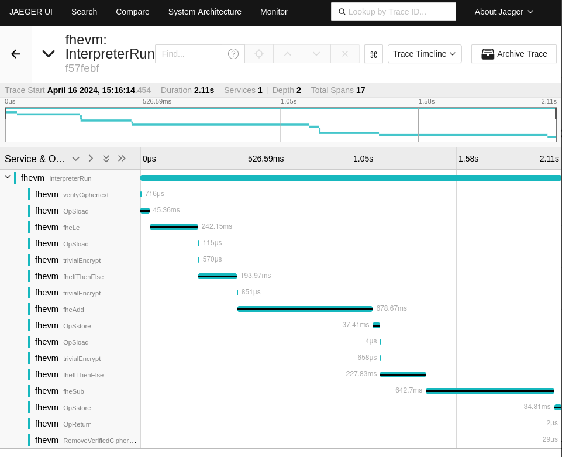

<!--
parent:
  order: false
-->


<p align="center">
<!-- product name logo -->
  
</p>
<hr/>
<p align="center">
  <a href="https://docs.zama.ai/fhevm"> 📒 Read documentation</a> | <a href="https://zama.ai/community"> 💛 Community support</a>
</p>
<p align="center">
<!-- Version badge using shields.io -->
  <a href="https://github.com/zama-ai/zbc-ethermint/releases/latest">
    
  </a>
<!-- Zama Bounty Program -->
  <a href="https://github.com/zama-ai/bounty-program">
    
  </a>
</p>
<hr/>

## Ethermint

Ethermint is a scalable and interoperable Ethereum library, built on
Proof-of-Stake with fast-finality using the
[Cosmos SDK](https://github.com/cosmos/cosmos-sdk/) which runs on top of
[CometBFT](https://github.com/cometbft/cometbft) consensus engine.

## About


For now Ethermint is using go-ethereum v1.13.5, with fhEVM support.

## Run the Ethermint node in the debugger (outdated)

If you want to go deeper in the code and need to add some breakpoints, follow this [tutorial](DEBUG.md) to build from sources and activate the debugger in vscode.


## How to run using docker images from registry

Ensure ```LOCAL_BUILD``` is set to **false** in .env.

To initalize and run the node:

```bash
make init-ethermint-node
make run-ethermint
# make stop-ethermint
# make clean
```

To run directly e2e test:

```bash
make e2e-test
```

Test are long and for 64 bits operations the computer could suffer a bit :).

Solution: wait until seeing the first test running, typically blind auction and stop the process (C^c). 

Then go to `work_dir/fhevm` and run the desired test:

```
npx hardhat test --grep 'transfer'
npx hardhat test --grep 'async'
npx hardhat test --grep 'manual'
```

Bonus: open [Jaeger UI](http://localhost:16686/search) to have some nices traces (select **fhevm** service and click on **Find Traces**).

Example of a ERC20 transfer trace:



## How to run using docker locally

Ensure ```LOCAL_BUILD``` is set to **true** in .env.

Run the following command to create the image **ethermintnodelocal**.

```bash
make build-local-docker
```

Init the node (configuration files)

```bash
make init-ethermint-node-local
```

This will create every needed files under __running_node/node1/.ethermintd__.
```bash
running_node/node1/.ethermintd/
.
├── config
│   ├── app.toml
│   ├── client.toml
│   ├── config.toml
│   ├── genesis.json
│   ├── gentx
│   │   └── gentx-bdaef3bad17f4da9489d90c139a3466145ca6f9d.json
│   ├── node_key.json
│   └── priv_validator_key.json
├── data
│   └── priv_validator_state.json
├── keyring-test
│   ├── ec41480801211af6f2aa0c1f2703b688bf460ef8.address
│   └── orchestrator.info
└── zama
    ├── config
    └── keys
        ├── kms-fhe-keys
        └── network-fhe-keys
```

Run/stop the node
```bash
make run-ethermint
make stop-ethermint
```

Get the logs
```bash
docker logs ethermintnodelocal0 -f
```

Give Alice (first account in fhevm test) some coins:
```bash
docker exec -i ethermintnodelocal0 faucet 0xa5e1defb98EFe38EBb2D958CEe052410247F4c80
# bob
docker exec -i ethermintnodelocal0 faucet 0xfCefe53c7012a075b8a711df391100d9c431c468
```

## Observability

**WARNING: we do not maintain metrics for this version.**

In order to run observability tools locally, just run the following command

```bash
$ make observability-start
```

> [!NOTE]
> The application is configured to send telemetry data to `localhost:4317` but you can change that by setting the `FHEVM_OTEL_COLLECTOR_ENDPOINT` envrionment variable. This is only needed if you change the collector endpoint.

This will start different services:
- **Jaeger:** Acessible at http://localhost:16686
- **Otel Collector:** This is where the app will be sending telemetry data, and is accessible at `localhost:4317`
- **Prometheus:** Accessible at http://localhost:6060
- **Grafana:** Accessible at http://localhost:3000

You can stop all the observability services running (no data will be retained)

```bash
$ make observability-stop
```

> [!NOTE]
> No data will be retained when you stop the different services

## Need support?

<a target="_blank" href="https://community.zama.ai">
  
</a>

## License

This software is distributed under the  LGPLv3. If you have any questions, please contact us at hello@zama.ai.

## About

Ethermint is a scalable and interoperable Ethereum library, built on
Proof-of-Stake with fast-finality using the
[Cosmos SDK](https://github.com/cosmos/cosmos-sdk/) which runs on top of
[Tendermint Core](https://github.com/tendermint/tendermint) consensus engine.

## Careers

See our open positions on [Greenhouse](https://evmos.org/careers).

## Community

The following chat channels and forums are a great spot to ask questions about
Ethermint:

- [Evmos Twitter](https://twitter.com/EvmosOrg)
- [Evmos Discord](https://discord.gg/trje9XuAmy)
- [Evmos Telegram](https://t.me/EvmosOrg)
- [Altiplanic Twitter](https://twitter.com/Altiplanic_io)
